# Pertemuan 5 — Visualisasi, KPI, dan Data Storytelling

**Durasi:** 19.30–21.00 WIB
**Tools:** Google Colab, Matplotlib, Seaborn, Plotly
**Output:** Peserta dapat memilih dan membuat grafik yang tepat, menghitung KPI, lalu menulis insight berbasis data.

## Cara Menjalankan Kode di Folder Ini

`pertemuan-5.ipynb` di folder ini adalah **hasil akhir** hands-on sesi ini, dan `data-bersih.csv` adalah dataset hasil cleaning pertemuan 4. Buka lewat [colab.research.google.com](https://colab.research.google.com/) (`File > Upload notebook`, lalu upload juga `data-bersih.csv` ke Colab lewat panel Files di sebelah kiri) atau lewat Jupyter Notebook lokal — pastikan `data-bersih.csv` ada di folder yang sama dengan notebook-nya. Matplotlib, Seaborn, dan Plotly sudah terpasang di Colab. Kalau ikut kelas dari awal, jangan buka file ini dulu: ikuti bagian Hands-on di bawah dan buat notebook sendiri. File ini jadi jaring pengaman kalau tertinggal.

Folder `gambar/` berisi gambar hasil tiap grafik, sebagai pembanding hasil milikmu.

## Tujuan Belajar

- Memilih jenis grafik sesuai pertanyaan dan tipe data.

- Membuat bar chart, line chart, histogram, boxplot, scatter plot, dan heatmap.

- Memakai Matplotlib, Seaborn, dan Plotly dasar.

- Menghitung KPI sederhana: total revenue, jumlah transaksi, rata-rata nilai pesanan, dan pertumbuhan bulanan.

- Mengubah temuan menjadi insight dengan rumus: temuan data + makna bisnis + rekomendasi.

- Mengenali grafik yang bisa menyesatkan, dan memeriksa grafik pakai checklist.

## Rundown

| Waktu | Aktivitas |
|---|---|
| 19.30–19.40 | Review EDA: angka belum otomatis menjadi insight |
| 19.40–20.05 | Prinsip visualisasi: audience, judul, warna, skala |
| 20.05–20.25 | Matplotlib dan Seaborn |
| 20.25–20.40 | Plotly untuk grafik interaktif |
| 20.40–20.52 | KPI dan data storytelling |
| 20.52–20.57 | Instruksi setup lokal sebelum sesi 6 |
| 20.57–21.00 | Rangkuman dan kuis 5 |

## Teori

### Dari Angka ke Gambar

Di pertemuan 4, hasil analisis kita masih berupa **tabel dan angka**: total penjualan per kategori, per bulan, per wilayah. Itu sudah benar, tapi coba bayangkan menyodorkan tabel 5 baris dan 3 kolom ke atasan yang cuma punya 10 detik. Mata kita jauh lebih cepat membaca **gambar** daripada deretan angka.

- Grafik membantu orang lain **langsung melihat polanya**: mana yang paling besar, mana yang naik, mana yang aneh.

- Tapi grafik **bukan insight**. Grafik cuma menampilkan data. Insight muncul kalau kita bisa bilang "jadi artinya apa, dan apa yang perlu dilakukan".

- Hari ini urutannya: pilih grafik yang tepat, buat dengan rapi, hitung KPI, lalu ceritakan hasilnya.

### Anatomi Sebuah Grafik

Grafik yang bisa dipahami orang lain punya lima bagian ini:

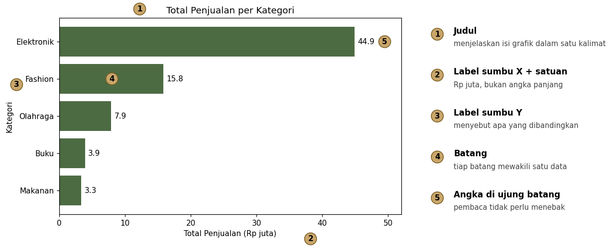

- **Judul** — satu kalimat yang menjelaskan isi grafik.

- **Label sumbu + satuan** — "Total Penjualan (Rp juta)" jauh lebih jelas daripada angka tanpa keterangan.

- **Data** — batang, garis, atau titik itu sendiri.

- **Label angka** — opsional, tapi sangat membantu supaya pembaca tidak perlu menebak.

- **Legenda** — kalau ada lebih dari satu warna atau garis, harus ada keterangan warna apa artinya apa.

### Memilih Grafik Sesuai Pertanyaan

Jangan mulai dari "mau bikin grafik apa", tapi dari **"mau jawab pertanyaan apa"**.

| Pertanyaan | Grafik yang umum dipakai |
|---|---|
| Bandingkan kategori | Bar chart |
| Lihat perubahan waktu | Line chart |
| Lihat sebaran angka | Histogram atau boxplot |
| Lihat hubungan dua angka | Scatter plot |

Contoh di data kita:

- "Kategori mana yang paling besar penjualannya?" → **bar chart**.

- "Penjualan naik atau turun dari bulan ke bulan?" → **line chart**.

- "Harga produk kebanyakan di kisaran berapa?" → **histogram**.

- "Apakah harga yang mahal selalu punya modal yang mahal?" → **scatter plot**.

### Setiap Grafik Punya Tugasnya

Tidak semua grafik bisa dipakai untuk semua masalah. Tiap grafik punya **tugas** sendiri. Salah pilih tugas, datanya tetap benar tapi pembaca jadi salah paham.

**Langkah 1: kenali jenis datanya.** Jenis data menentukan grafik apa yang masuk akal.

| Jenis data | Contoh di data penjualan | Ciri |
|---|---|---|
| **Kategori** | kategori produk, wilayah | Teks yang mengelompokkan |
| **Angka** | harga, jumlah, untung | Bisa dijumlah atau dirata-rata |
| **Waktu** | tanggal, bulan | Punya urutan dari lama ke baru |

**Langkah 2: cocokkan masalah dengan grafiknya.**

| Masalah | Grafik | Data yang dibutuhkan | Jangan dipakai kalau |
|---|---|---|---|
| Membandingkan kategori ("mana yang paling besar?") | Bar chart | 1 kategori + 1 angka | Datanya urutan waktu |
| Tren dari waktu ke waktu ("naik atau turun?") | Line chart | waktu + angka | Sumbu X bukan urutan (kategori acak) |
| Sebaran satu angka ("kebanyakan di mana?") | Histogram | 1 angka | Mau membandingkan kategori |
| Sebaran antar kelompok, atau mencari outlier | Boxplot | angka + kategori | Data per kelompok sangat sedikit |
| Hubungan dua angka ("ikut naik tidak?") | Scatter plot | 2 angka | Salah satunya bukan angka |
| Porsi dari satu keseluruhan | Pie chart | 2 sampai 4 bagian | Bagian banyak, atau tidak menjumlah ke satu keseluruhan |
| Pola di tabel dua dimensi, korelasi | Heatmap | tabel kategori × kategori atau angka | Datanya cuma satu dimensi |

**Langkah 3: tiga pertanyaan sebelum memilih.**

1. **Apa yang mau dijawab?** Membandingkan, melihat tren, melihat sebaran, melihat hubungan, atau melihat porsi?

2. **Jenis data apa yang kupunya?** Kategori, angka, atau waktu?

3. **Siapa pembacanya?** Pembaca awam butuh grafik yang paling sederhana.

**Contoh salah pilih.** Masalah yang sama, digambar dengan grafik yang kurang tepat (kiri) dan yang tepat (kanan). Semua data di bawah buatan sendiri, bukan dari dataset penjualan.

*Membandingkan kategori.* Garis menyiratkan ada urutan dari satu titik ke titik berikutnya. Antar kategori tidak ada urutan itu, jadi pakai bar chart.

```python
kategori = ["Kuliner", "Fashion", "Kerajinan", "Buku"]
nilai_kat = [45, 30, 12, 20]

fig, (kiri, kanan) = plt.subplots(1, 2, figsize=(10, 3.4))

kiri.plot(kategori, nilai_kat, marker="o")
kiri.set_title("Kurang tepat: garis antar kategori")

kanan.bar(kategori, nilai_kat, color="#4d6b43")
kanan.set_title("Tepat: bar chart")

for ax in (kiri, kanan):
    ax.set_ylabel("Penjualan (Rp juta)")

plt.tight_layout()
plt.show()
```

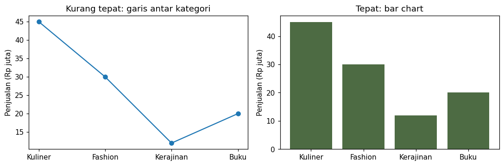

*Tren waktu.* Pie chart menjawab "porsi", bukan "naik atau turun". Untuk tren, pakai line chart.

```python
bulan_enam = ["Jan", "Feb", "Mar", "Apr", "Mei", "Jun"]
omzet_enam = [10, 12, 9, 15, 18, 22]

fig, (kiri, kanan) = plt.subplots(1, 2, figsize=(10, 3.4))

kiri.pie(omzet_enam, labels=bulan_enam)
kiri.set_title("Kurang tepat: pie untuk tren")

kanan.plot(bulan_enam, omzet_enam, marker="o", color="#4d6b43")
kanan.set_title("Tepat: line chart")
kanan.set_ylabel("Omzet (Rp juta)")

plt.tight_layout()
plt.show()
```

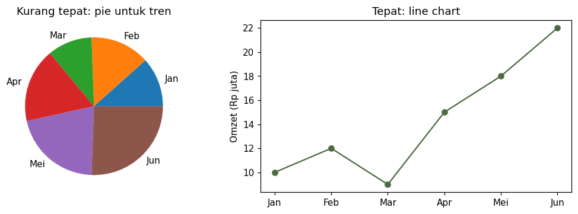

*Sebaran angka.* Bar chart per orang menampilkan nilai satu-satu dan sulit dilihat bentuk sebarannya. Histogram mengelompokkan angka ke rentang.

```python
nilai_20 = [55, 58, 60, 62, 63, 65, 65, 66, 68, 70,
            70, 71, 72, 74, 75, 75, 78, 80, 85, 92]

fig, (kiri, kanan) = plt.subplots(1, 2, figsize=(10, 3.4))

kiri.bar(range(len(nilai_20)), nilai_20)
kiri.set_title("Kurang tepat: bar per orang")
kiri.set_xlabel("Siswa ke-")
kiri.set_ylabel("Nilai")

kanan.hist(nilai_20, bins=6, color="#4d6b43")
kanan.set_title("Tepat: histogram")
kanan.set_xlabel("Nilai")
kanan.set_ylabel("Jumlah siswa")

plt.tight_layout()
plt.show()
```

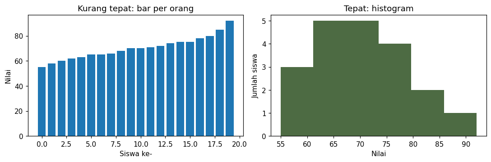

*Sebaran antar kelompok.* Dua kelas ini rata-ratanya sama persis. Bar chart rata-rata menyembunyikan beda sebarannya, boxplot memperlihatkannya.

```python
kelas_a = [48, 49, 50, 50, 50, 51, 52]      # nilai berkumpul di sekitar 50
kelas_b = [20, 30, 45, 50, 55, 70, 80]      # nilai tersebar jauh

rata_a = sum(kelas_a) / len(kelas_a)
rata_b = sum(kelas_b) / len(kelas_b)
print("Rata-rata kelas A:", rata_a)
print("Rata-rata kelas B:", rata_b)

fig, (kiri, kanan) = plt.subplots(1, 2, figsize=(10, 3.4))

kiri.bar(["Kelas A", "Kelas B"], [rata_a, rata_b])
kiri.set_title("Kurang tepat: rata-rata saja")
kiri.set_ylabel("Nilai rata-rata")

kanan.boxplot([kelas_a, kelas_b], tick_labels=["Kelas A", "Kelas B"])
kanan.set_title("Tepat: boxplot")
kanan.set_ylabel("Nilai")

plt.tight_layout()
plt.show()
```

```text
Rata-rata kelas A: 50.0
Rata-rata kelas B: 50.0
```

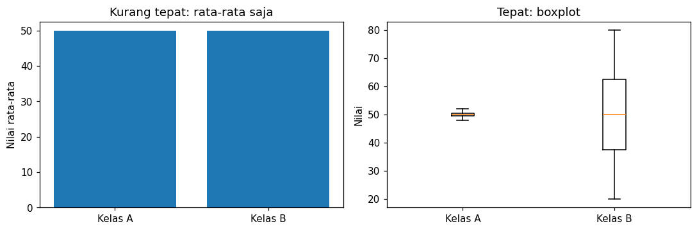

*Hubungan dua angka.* Garis yang menghubungkan titik-titik zig-zag dan menyiratkan urutan. Yang dicari adalah pola sebarannya, jadi pakai scatter plot.

```python
iklan = [5, 12, 8, 20, 15, 25, 10, 30, 18, 22]
penjualan_iklan = [20, 35, 28, 55, 42, 60, 30, 75, 50, 58]

fig, (kiri, kanan) = plt.subplots(1, 2, figsize=(10, 3.4))

kiri.plot(iklan, penjualan_iklan, marker="o")
kiri.set_title("Kurang tepat: garis zig-zag")

kanan.scatter(iklan, penjualan_iklan, color="#4d6b43")
kanan.set_title("Tepat: scatter plot")

for ax in (kiri, kanan):
    ax.set_xlabel("Biaya iklan (Rp juta)")
    ax.set_ylabel("Penjualan (Rp juta)")

plt.tight_layout()
plt.show()
```

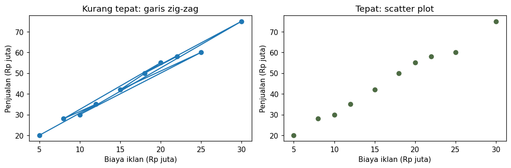

*Porsi.* Pie chart baik untuk 2 sampai 4 bagian. Kalau bagiannya banyak, pakai bar chart yang diurutkan.

```python
produk_8 = ["A", "B", "C", "D", "E", "F", "G", "H"]
porsi_8 = [22, 18, 15, 12, 10, 8, 8, 7]

fig, (kiri, kanan) = plt.subplots(1, 2, figsize=(10, 3.6))

kiri.pie(porsi_8, labels=produk_8, autopct="%1.0f%%")
kiri.set_title("Kurang tepat: pie dengan 8 irisan")

kanan.barh(produk_8[::-1], porsi_8[::-1], color="#4d6b43")
kanan.set_title("Tepat: bar chart urut")
kanan.set_xlabel("Porsi (%)")

plt.tight_layout()
plt.show()
```

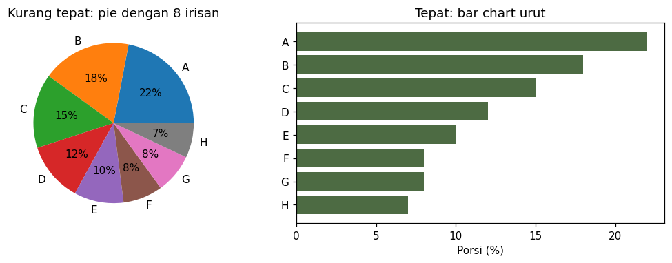

Ringkasnya: **pilih grafik dari pertanyaannya dan jenis datanya, bukan dari grafik apa yang kelihatan bagus.**

> Kelompok sub-bab dari sini sampai "Satu Grafik, Tiga Library" adalah **bahan referensi dan belajar mandiri**. Contohnya sengaja memakai data kecil buatan sendiri, bukan dataset penjualan, supaya fokusnya cuma satu: cara kerja library. Versi notebook-nya ada di bagian **0b** dan **0c**, dan ada **Cheatsheet** di akhir notebook.

### Grafik yang Menyesatkan

Grafik yang salah pilih atau salah buat bisa membuat orang menarik kesimpulan yang keliru, walaupun datanya benar.

- **Pie chart untuk banyak kategori.** Irisan kecil sulit dibandingkan dan labelnya bertumpuk. Pie chart masih oke kalau cuma 2–3 bagian dari satu keseluruhan. Untuk membandingkan banyak kategori, pakai bar chart.

- **Sumbu Y tidak dimulai dari 0.** Selisih kecil bisa kelihatan seperti lonjakan besar. Untuk bar dan line chart, mulai dari 0 kecuali ada alasan kuat.

- **Warna berlebihan.** Lima warna cerah di satu grafik membuat mata bingung harus melihat ke mana.

- **Efek 3D.** Menambah hiasan, mengurangi keterbacaan.

- **Kesimpulan melebihi bukti.** Ini yang paling berbahaya, dan kita akan lihat contoh nyatanya di bagian Jebakan.

### Prinsip Visualisasi

Empat hal yang perlu ditanyakan sebelum membuat grafik:

- **Audience** — siapa yang akan membaca? Atasan butuh gambaran cepat, tim analis butuh detail.

- **Judul** — apakah judulnya sudah menjawab "ini grafik tentang apa"?

- **Warna** — pakai sedikit saja. Aturan gampang: **satu warna utama, satu warna untuk menyorot** hal yang mau ditekankan.

- **Skala** — sumbu mulai dari mana, satuannya apa, apakah angkanya mudah dibaca (lebih enak "44,9 juta" daripada "44893000").

### Checklist Grafik yang Baik

Sebelum grafik dibagikan, cek lima hal ini:

- [ ] Judul jelas.

- [ ] Label sumbu ada.

- [ ] Satuan terbaca.

- [ ] Warna tidak berlebihan.

- [ ] Kesimpulan tidak melebihi bukti.

Checklist ini dipakai di Latihan Gabungan, saat kamu dan temanmu saling memeriksa grafik.

### Matplotlib: Fondasi Grafik di Python

**Matplotlib** adalah library dasar untuk membuat grafik di Python. Library lain (termasuk Seaborn) dibangun di atasnya.

```python
import matplotlib.pyplot as plt
```

| Fungsi | Gunanya |
|---|---|
| `plt.bar()` / `plt.barh()` | Bar chart tegak / mendatar |
| `plt.plot()` | Line chart |
| `plt.hist()` | Histogram |
| `plt.scatter()` | Scatter plot |
| `plt.pie()` | Pie chart |
| `plt.title()` | Memberi judul |
| `plt.xlabel()` / `plt.ylabel()` | Memberi label sumbu |
| `plt.show()` | Menampilkan grafik |

Urutan kerjanya selalu sama: **gambar dulu, hiasi, baru `plt.show()`**.

Untuk menaruh dua grafik berdampingan, kita pakai `plt.subplots()`:

```python
fig, (kiri, kanan) = plt.subplots(1, 2, figsize=(11, 4))
kiri.set_title("Grafik kiri")
kanan.set_title("Grafik kanan")
```

- `fig` itu **kertasnya** (Figure), `kiri` dan `kanan` itu **kotak-kotak gambarnya** (Axes).

- `plt.title(...)` dan `kiri.set_title(...)` sama-sama memberi judul. Bedanya, `plt.title` untuk satu grafik biasa, `set_title` untuk memilih kotak mana yang diberi judul.

### Bar Chart dan Line Chart

```python
plt.barh(urut["kategori"], urut["total_juta"])   # bar chart mendatar
plt.plot(df_bulanan["bulan"], df_bulanan["total_juta"], marker="o")   # line chart
```

- `barh` menggambar batang **mendatar** dari bawah ke atas, jadi data diurutkan dari kecil ke besar supaya yang terbesar ada di atas.

- Bar chart mendatar enak dipakai kalau nama kategorinya panjang.

- `marker="o"` memberi titik di setiap data pada line chart.

- Angka rupiah dibagi 1.000.000 (jadi **Rp juta**) supaya sumbu tidak menampilkan `1e7`.

- Loop `for i, nilai in enumerate(...)` dari pertemuan 2 dipakai untuk menulis angka di ujung batang dengan `plt.text()`.

### Histogram dan Scatter Plot

```python
plt.hist(df["harga_ribu"], bins=20)             # sebaran satu angka
plt.scatter(df["modal_ribu"], df["harga_ribu"]) # hubungan dua angka
```

- **Histogram:** data dikelompokkan ke rentang angka (`bins`), tinggi batang = jumlah data di rentang itu. Berguna untuk melihat angka kebanyakan ada di mana.

- Kalau ada satu nilai yang jauh sekali, histogram jadi "gepeng": hampir semua data menumpuk di satu batang. Itu tanda ada outlier.

- **Scatter plot:** satu titik = satu data, posisi ditentukan dua angka. Kalau titiknya membentuk garis miring naik, dua angka itu cenderung naik bareng.

### Cara Kerja Matplotlib: Figure dan Axes

Bayangkan menggambar di atas kertas. **Figure** itu kertasnya, **Axes** itu kotak gambar di atas kertas (tempat sumbu, garis, dan batang digambar). Satu kertas bisa berisi beberapa kotak gambar.

Ada dua gaya menulis, hasilnya sama:

- **Gaya `plt.`** — Matplotlib otomatis memakai "kotak yang sedang aktif". Enak untuk satu grafik.

- **Gaya `ax.`** — kita sendiri yang memegang kotak gambarnya. Wajib kalau mau beberapa grafik berdampingan.

Gaya `plt.`:

```python
import matplotlib.pyplot as plt

produk = ["Mouse", "Kaos", "Novel"]
terjual = [30, 50, 20]

# Gaya plt: gambar dulu, hiasi, baru tampilkan
plt.bar(produk, terjual)
plt.title("Jumlah Terjual per Produk")
plt.xlabel("Produk")
plt.ylabel("Jumlah terjual (pcs)")
plt.show()
```


Gaya `ax.` (hasilnya sama persis):

```python
# Gaya ax: sama persis hasilnya, tapi kita pegang kotak gambarnya (ax)
fig, ax = plt.subplots()
ax.bar(produk, terjual)
ax.set_title("Jumlah Terjual per Produk")
ax.set_xlabel("Produk")
ax.set_ylabel("Jumlah terjual (pcs)")
plt.show()
```


Perhatikan polanya: `plt.title(...)` berubah jadi `ax.set_title(...)`, `plt.xlabel(...)` jadi `ax.set_xlabel(...)`. Selalu sama.

Alurnya selalu: **siapkan kertas, gambar, hiasi, tampilkan**.

### Contoh Matplotlib yang Sering Dipakai

Semua contoh di sini memakai data kecil. Blok-blok ini bersambung: variabel seperti `produk`, `terjual`, dan `bulan` dibuat di blok sebelumnya.

**Dua garis + legend.** `label=` menamai tiap garis, `plt.legend()` menampilkannya. `marker` dan `linestyle` membedakan garis.

```python
bulan = ["Jan", "Feb", "Mar", "Apr"]
omzet_a = [10, 12, 9, 15]
omzet_b = [7, 9, 11, 10]

# label= dipakai legend() untuk menamai tiap garis
plt.plot(bulan, omzet_a, marker="o", linestyle="-", label="Produk A")
plt.plot(bulan, omzet_b, marker="s", linestyle="--", label="Produk B")
plt.title("Omzet Dua Produk")
plt.xlabel("Bulan")
plt.ylabel("Omzet (Rp juta)")
plt.legend()
plt.show()
```

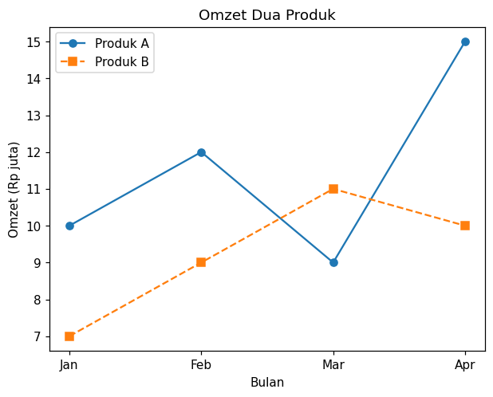

**Scatter: ukuran dan warna.** `s=` ukuran titik, `c=` warna, `alpha=` transparansi (0 sampai 1) supaya titik yang bertumpuk tetap kelihatan.

```python
x = [1, 2, 3, 4, 5, 6]
y = [2, 4, 5, 4, 6, 8]
ukuran = [40, 80, 120, 60, 200, 100]

plt.scatter(x, y, s=ukuran, c="green", alpha=0.5)
plt.title("Scatter dengan Ukuran Titik Berbeda")
plt.xlabel("x")
plt.ylabel("y")
plt.show()
```

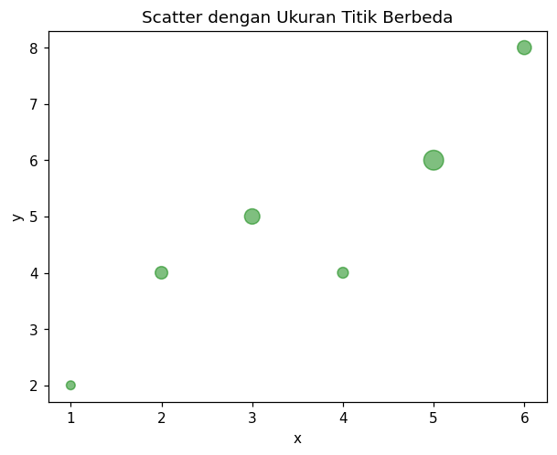

**Histogram: `bins`.** `bins` adalah jumlah "keranjang". Sedikit = kasar, banyak = detail.

```python
nilai_ujian = [55, 60, 62, 65, 65, 68, 70, 70, 72, 75, 75, 78, 80, 85, 90]

fig, (kiri, kanan) = plt.subplots(1, 2, figsize=(9, 3.2))

kiri.hist(nilai_ujian, bins=3)
kiri.set_title("bins=3 (kasar)")

kanan.hist(nilai_ujian, bins=10)
kanan.set_title("bins=10 (lebih detail)")

for ax in (kiri, kanan):
    ax.set_xlabel("Nilai")
    ax.set_ylabel("Jumlah siswa")

plt.tight_layout()
plt.show()
```

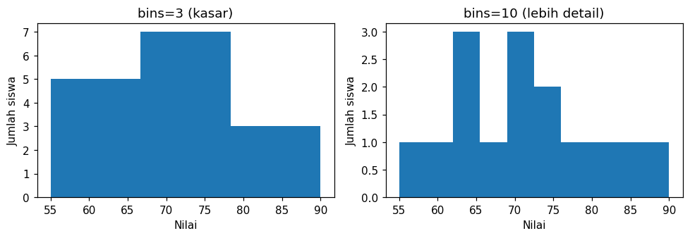

**Pie chart: `autopct`.** Menampilkan persen di tiap irisan. Ingat, pie cuma untuk 2 sampai 4 bagian.

```python
metode = ["Tunai", "Transfer", "E-wallet"]
porsi_bayar = [50, 30, 20]

plt.pie(porsi_bayar, labels=metode, autopct="%1.0f%%")
plt.title("Metode Pembayaran")
plt.show()
```

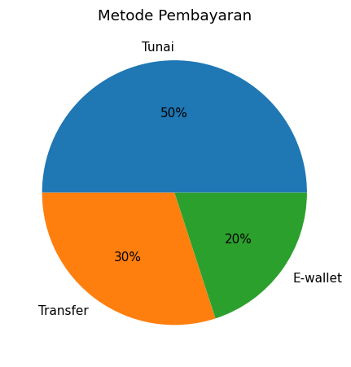

**Dua grafik berdampingan: `subplots`.** `plt.subplots(1, 2)` artinya 1 baris, 2 kolom. `suptitle` memberi judul untuk seluruh kertas, `tight_layout()` merapikan jarak.

```python
fig, (kiri, kanan) = plt.subplots(1, 2, figsize=(9, 3.2))

kiri.bar(produk, terjual)
kiri.set_title("Terjual per Produk")

kanan.plot(bulan, omzet_a, marker="o")
kanan.set_title("Omzet Produk A")

fig.suptitle("Dua Grafik Satu Kertas")
plt.tight_layout()
plt.show()
```

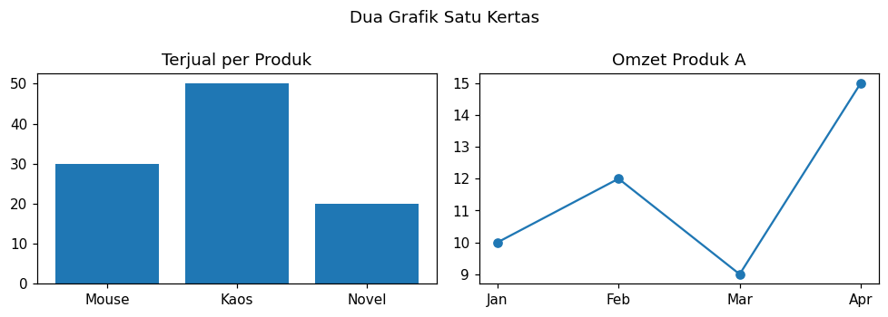

**Hiasan yang paling sering dipakai.** Ukuran gambar, warna, label miring, garis bantu, dan menyimpan jadi file.

```python
nama_toko = ["Warung Bu Sari", "Batik Karawang Asli", "Anyaman Bambu Pak Jaya"]
nilai_toko = [12, 18, 9]

plt.figure(figsize=(7, 3.5))                       # ukuran gambar (lebar, tinggi)
plt.bar(nama_toko, nilai_toko, color="#4d6b43")    # warna batang
plt.xticks(rotation=15)                            # miringkan label yang panjang
plt.grid(axis="y", linestyle=":")                  # garis bantu horizontal
plt.title("Hiasan yang Sering Dipakai")
plt.ylabel("Nilai")
plt.savefig("grafik_contoh.png", dpi=150, bbox_inches="tight")   # simpan jadi file
plt.show()
```

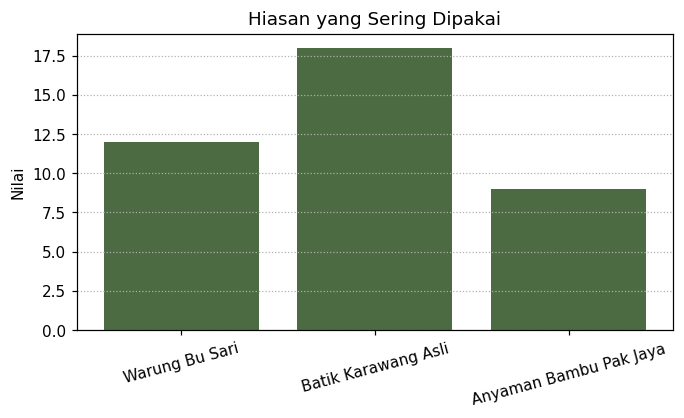

### Seaborn: Matplotlib yang Lebih Ringkas

**Seaborn** dibangun di atas Matplotlib. Dia paham DataFrame, jadi kita cukup menyebut nama tabel dan nama kolom.

```python
import seaborn as sns

sns.set_theme(style="whitegrid")
sns.barplot(data=ringkasan, x="total_juta", y="kategori")
sns.boxplot(x=df["harga_ribu"])
sns.scatterplot(data=df, x="modal_ribu", y="harga_ribu", hue="kategori")
```

- `data=`, `x=`, `y=` — tabel mana, kolom mana untuk sumbu X dan Y.

- `hue="kategori"` — warna titik dibedakan per kategori, sekaligus membuat legenda otomatis.

- Judul dan label tetap pakai `plt.title()` / `plt.xlabel()`, karena Seaborn jalan di atas Matplotlib.

- **Boxplot** adalah gambar dari aturan **IQR** di pertemuan 4: kotak = dari Q1 sampai Q3, garis di tengah kotak = median, garis panjang di kiri-kanan = batas wajar, titik di luar garis = **outlier**.

### Cara Kerja Seaborn: Tabel yang Rapi

Seaborn paham **DataFrame**. Syaratnya, tabelnya **rapi**: satu baris = satu kejadian, satu kolom = satu hal yang dicatat. Kita cukup menyebut nama tabel dan nama kolom, Seaborn yang mengurus sisanya, termasuk **menghitung ringkasan sendiri**.

```python
import pandas as pd
import seaborn as sns

toy = pd.DataFrame({
    "kota": ["Jakarta", "Jakarta", "Bandung", "Bandung", "Bandung", "Medan", "Medan", "Jakarta"],
    "kategori": ["Makanan", "Buku", "Makanan", "Buku", "Makanan", "Buku", "Makanan", "Makanan"],
    "penjualan": [30, 12, 25, 10, 28, 8, 22, 35],
})
display(toy)
```

```text
      kota kategori  penjualan
0  Jakarta  Makanan         30
1  Jakarta     Buku         12
2  Bandung  Makanan         25
3  Bandung     Buku         10
4  Bandung  Makanan         28
5    Medan     Buku          8
6    Medan  Makanan         22
7  Jakarta  Makanan         35
```

Tabel kecil ini dipakai di semua contoh Seaborn di bawah.

### Contoh Seaborn yang Sering Dipakai

**`barplot` vs `countplot`.** Dua-duanya batang, tugasnya beda.

- `barplot` — tinggi batang = **rata-rata** kolom angka (`y`) per kelompok.

- `countplot` — tinggi batang = **jumlah baris** per kelompok. Tidak butuh `y`.

`errorbar=None` mematikan garis kecil di ujung batang (rentang kepercayaan) supaya grafik tidak membingungkan di awal. `ax=` menentukan kotak gambar mana yang dipakai.

```python
fig, (kiri, kanan) = plt.subplots(1, 2, figsize=(10, 3.6))

sns.barplot(data=toy, x="kota", y="penjualan", errorbar=None, ax=kiri)
kiri.set_title("barplot: RATA-RATA penjualan per kota")

sns.countplot(data=toy, x="kota", ax=kanan)
kanan.set_title("countplot: JUMLAH baris per kota")

plt.tight_layout()
plt.show()
```

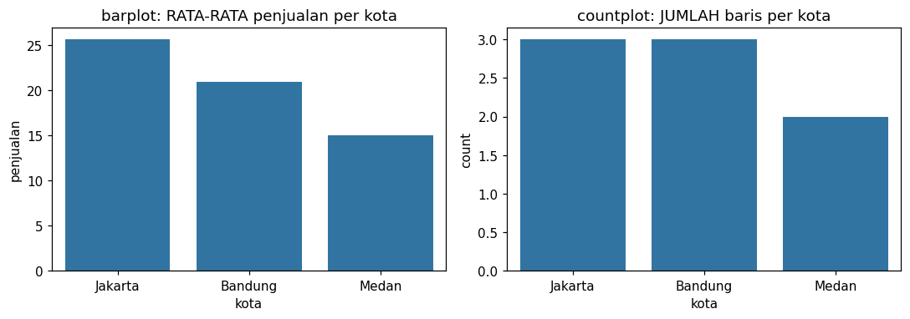

**`hue` dan `palette`.** `hue="kategori"` memecah batang jadi beberapa warna sesuai isi kolom itu, lengkap dengan legend otomatis. `palette` memilih kumpulan warnanya.

```python
sns.barplot(data=toy, x="kota", y="penjualan", hue="kategori",
            errorbar=None, palette="Set2")
plt.title("Rata-rata Penjualan per Kota dan Kategori")
plt.show()
```

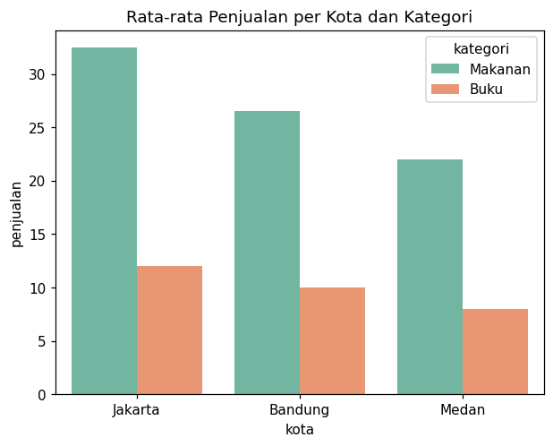

**`histplot` dengan `kde=True`.** Menambah garis mulus yang menunjukkan "bentuk" sebarannya.

```python
sns.histplot(nilai_ujian, bins=6, kde=True)
plt.title("Sebaran Nilai Ujian")
plt.xlabel("Nilai")
plt.ylabel("Jumlah siswa")
plt.show()
```

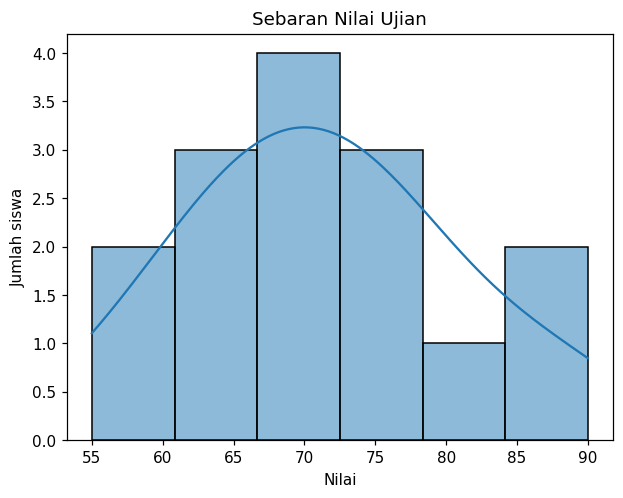

**`boxplot` per kelompok.** Kotak = separuh data di tengah (Q1 sampai Q3), garis di dalam kotak = median.

```python
sns.boxplot(data=toy, x="kategori", y="penjualan")
plt.title("Sebaran Penjualan per Kategori")
plt.show()
```

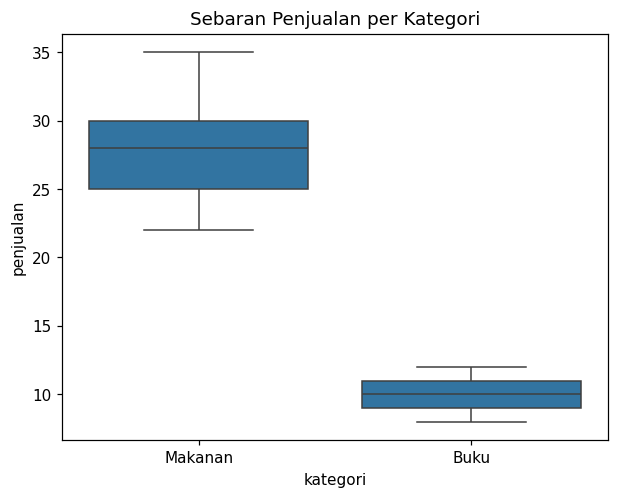

**`set_theme`: ganti tampilan satu baris.** Satu baris di awal mengubah tampilan semua grafik sesudahnya. `sns.reset_defaults()` mengembalikannya ke bawaan.

```python
# Tampilan bawaan Matplotlib
plt.bar(produk, terjual)
plt.title("Tampilan bawaan")
plt.show()

# Satu baris, tampilan berubah untuk semua grafik sesudahnya
sns.set_theme(style="whitegrid")
plt.bar(produk, terjual)
plt.title("Sesudah set_theme(style='whitegrid')")
plt.show()

sns.reset_defaults()   # kembalikan ke tampilan bawaan
```

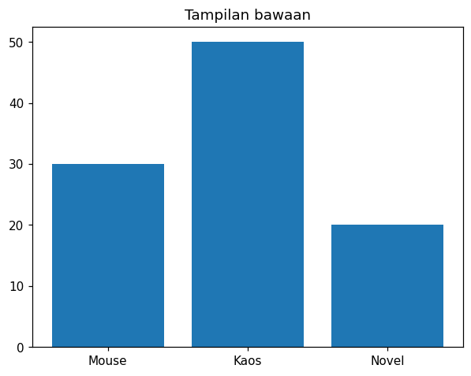


### Heatmap: Tabel yang Diberi Warna

**Heatmap** adalah tabel yang tiap kotaknya diwarnai sesuai besar angkanya. Makin pekat warnanya, makin besar angkanya. Kalau diberi `annot=True`, angkanya juga ditulis di dalam kotak.

```python
sns.heatmap(pivot, annot=True, fmt=".1f", cmap="Greens")
```

- `pivot` — tabel dari `pivot_table` pertemuan 4 (wilayah × kategori).

- `annot=True` — tulis angka di tiap kotak.

- `fmt=".1f"` — format angkanya: 1 angka di belakang koma.

- `cmap="Greens"` — palet warnanya (hijau: dari muda ke tua). Ada banyak pilihan lain, misalnya `"coolwarm"`.

Heatmap cocok untuk melihat pola di tabel dua dimensi, seperti "kategori apa laris di wilayah mana", yang susah dibaca kalau cuma berupa deretan angka.

### Korelasi: Dua Angka Bergerak Bareng?

**Korelasi** mengukur seberapa kompak dua angka bergerak bersama. Nilainya selalu antara **-1 sampai 1**.

| Nilai korelasi | Artinya |
|---|---|
| Dekat 1 | Naik bareng: yang satu naik, yang lain ikut naik |
| Dekat 0 | Tidak ada hubungan yang jelas |
| Dekat -1 | Berlawanan: yang satu naik, yang lain turun |

```python
kolom = ["harga", "jumlah", "modal", "nilai_penjualan", "untung"]
df[kolom].corr()
sns.heatmap(df[kolom].corr(), annot=True, fmt=".2f", cmap="coolwarm", vmin=-1, vmax=1)
```

- `vmin=-1, vmax=1` mengunci skala warna dari -1 sampai 1, supaya warna selalu bermakna sama.

Tiga hal yang wajib diingat:

- **Korelasi bukan sebab-akibat.** Dua angka bergerak bareng belum tentu yang satu menyebabkan yang lain.

- **Hati-hati dengan kolom yang saling terhubung rumus.** `nilai_penjualan` itu `harga × jumlah`, jadi wajar kalau korelasinya tinggi. Itu bukan temuan.

- **Outlier bisa menipu korelasi.** Satu data yang ekstrem bisa membuat korelasi terlihat hampir sempurna. Kita buktikan di langkah 12.

### Plotly: Grafik Interaktif

**Plotly** membuat grafik yang bisa **di-hover** (muncul angkanya saat kursor diarahkan) dan **di-zoom**. Cocok untuk dashboard, yang kita buat di pertemuan 6.

```python
import plotly.express as px

fig = px.line(df_bulanan, x="bulan", y="total_juta", markers=True,
              title="Tren Penjualan Bulanan")
fig.show()
```

- `px.line`, `px.bar`, `px.scatter` — satu baris untuk satu jenis grafik, dengan pola yang sama seperti Seaborn: tabel, kolom X, kolom Y.

- `fig.update_layout(...)` — mengubah label sumbu dan tampilan lainnya.

- `fig.show()` — menampilkan grafik interaktifnya.

- Gambar di README ini diam (screenshot), tapi di Colab kamu bisa mengarahkan kursor dan melihat angkanya muncul.

### Cara Kerja Plotly: Objek Figure

Plotly beda dari Matplotlib. `px.bar(...)` tidak menggambar langsung. Dia membuat sebuah **objek `Figure`**: catatan berisi data dan gaya grafik. Objek itu lalu digambar oleh **plotly.js di browser**, itulah kenapa grafiknya bisa di-hover dan di-zoom.

- `fig.show()` — menampilkan di notebook.

- `fig.write_html("nama.html")` — menyimpan jadi halaman web yang tetap interaktif, bisa dikirim ke orang lain.

- Polanya sama seperti Seaborn: tabel, kolom X, kolom Y.

```python
import plotly.express as px

toy_p = pd.DataFrame({
    "produk": ["Mouse", "Kaos", "Novel", "Topi"],
    "terjual": [30, 50, 20, 35],
})

fig = px.bar(toy_p, x="produk", y="terjual", title="Jumlah Terjual per Produk")
fig.show()
```

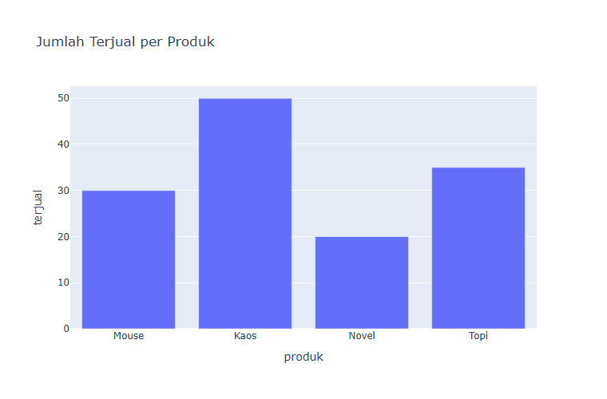

Gambar di README ini diam (screenshot). Di Colab, grafiknya bisa kamu arahkan kursornya.

### Contoh Plotly yang Sering Dipakai

**`px.line` dengan `color=`.** Satu garis per isi kolom `produk`, lengkap dengan legend.

```python
omzet_df = pd.DataFrame({
    "bulan": ["Jan", "Feb", "Mar"] * 2,
    "produk": ["A"] * 3 + ["B"] * 3,
    "omzet": [10, 12, 9, 7, 9, 11],
})

fig = px.line(omzet_df, x="bulan", y="omzet", color="produk", markers=True,
              title="Omzet per Bulan")
fig.show()
```

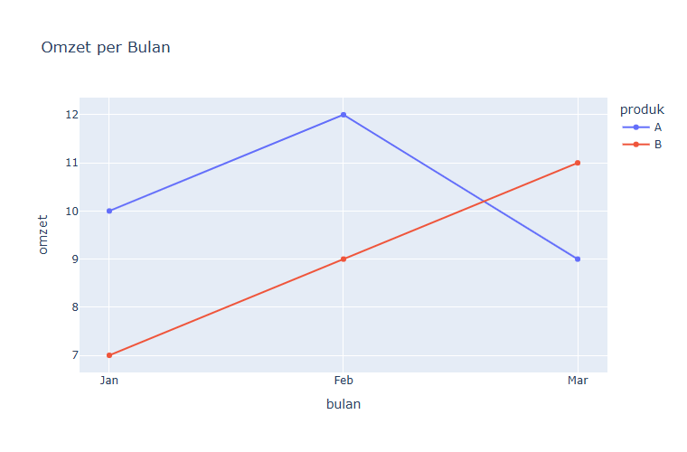

**`px.scatter` dengan `size` dan `hover_data`.** `size` membuat besar titik mengikuti sebuah kolom. `hover_name` dan `hover_data` menambah info yang muncul saat kursor diarahkan ke titik.

```python
produk_df = pd.DataFrame({
    "nama": ["Mouse", "Kaos", "Novel", "Topi", "Tas"],
    "harga": [150, 75, 60, 40, 220],
    "rating": [4.5, 4.0, 4.8, 3.9, 4.2],
    "stok": [20, 50, 10, 35, 15],
})

fig = px.scatter(produk_df, x="harga", y="rating", size="stok",
                 hover_name="nama", hover_data=["stok"],
                 title="Harga vs Rating (besar titik = stok)")
fig.show()
```

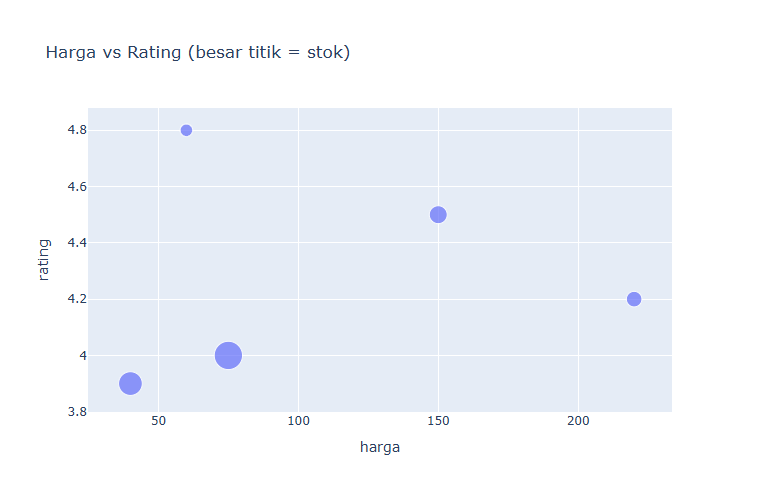

**`update_layout` dan `update_traces`.**

- `update_traces(...)` — mengatur **isi grafik** (warna batang, garis).

- `update_layout(...)` — mengatur **kerangka grafik** (judul, label sumbu, ukuran).

```python
fig = px.bar(toy_p, x="produk", y="terjual")
fig.update_traces(marker_color="#4d6b43")
fig.update_layout(
    title="Jumlah Terjual per Produk",
    xaxis_title="Produk",
    yaxis_title="Jumlah terjual (pcs)",
)
fig.write_html("grafik_interaktif.html")   # simpan jadi halaman web
fig.show()
```

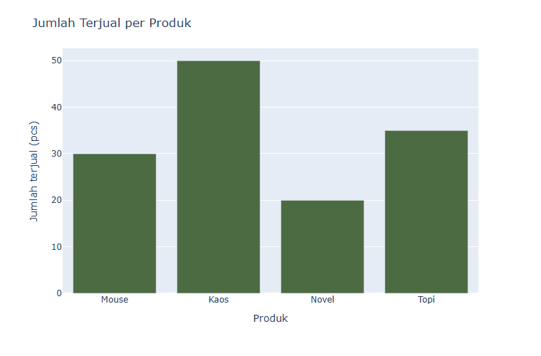

**`px.histogram` dan `px.pie`.**

```python
fig = px.histogram(x=nilai_ujian, nbins=6, title="Sebaran Nilai Ujian")
fig.update_layout(xaxis_title="Nilai", yaxis_title="Jumlah siswa")
fig.show()

fig = px.pie(names=metode, values=porsi_bayar, title="Metode Pembayaran")
fig.show()
```

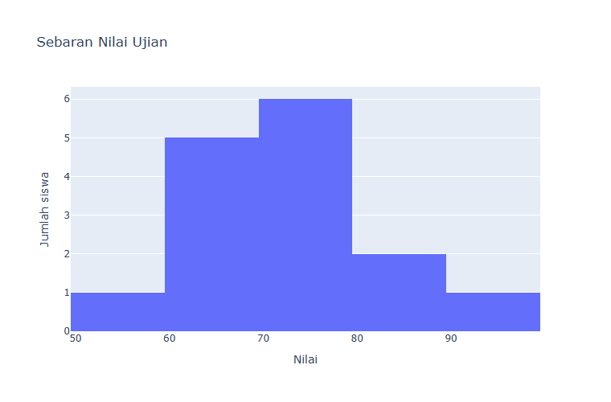

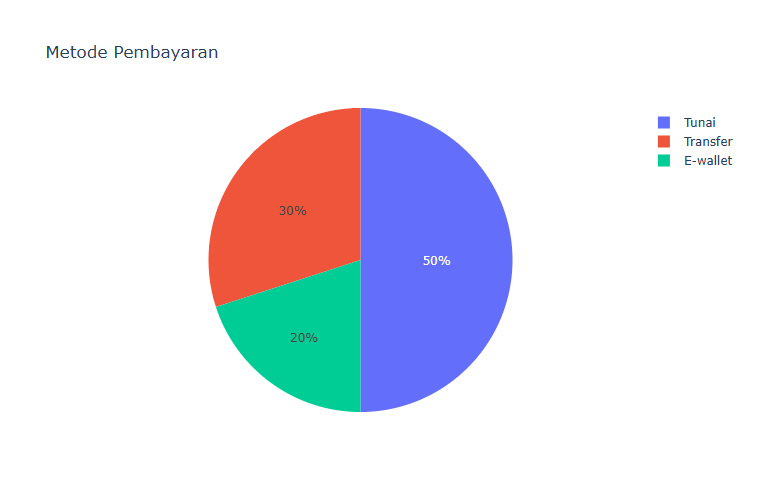

### Kapan Pakai yang Mana

| Library | Kelebihan | Cocok untuk |
|---|---|---|
| Matplotlib | Paling fleksibel, semua grafik bisa dibuat | Dasar, dan grafik yang butuh pengaturan detail |
| Seaborn | Kode lebih pendek, tampilan lebih enak, paham DataFrame | Analisis cepat, boxplot, heatmap |
| Plotly | Interaktif (hover, zoom) | Dashboard dan presentasi online |

Tidak harus memilih satu: ketiganya sering dipakai bergantian di proyek yang sama.

### Satu Grafik, Tiga Library

Bar chart yang sama dibuat di ketiga library. Hasilnya mirip, bedanya di cara menulis dan sifat hasilnya (gambar diam atau interaktif).

Matplotlib: gambar sendiri, hiasi sendiri.

```python
# Matplotlib: gambar sendiri, hiasi sendiri
plt.bar(produk, terjual)
plt.title("Jumlah Terjual per Produk")
plt.xlabel("Produk")
plt.ylabel("Jumlah terjual (pcs)")
plt.show()
```


Seaborn: sebut tabel dan kolomnya, judul tetap lewat `plt`.

```python
# Seaborn: sebut tabel dan kolomnya, judul tetap lewat plt
tabel = pd.DataFrame({"produk": produk, "terjual": terjual})

sns.barplot(data=tabel, x="produk", y="terjual")
plt.title("Jumlah Terjual per Produk")
plt.xlabel("Produk")
plt.ylabel("Jumlah terjual (pcs)")
plt.show()
```

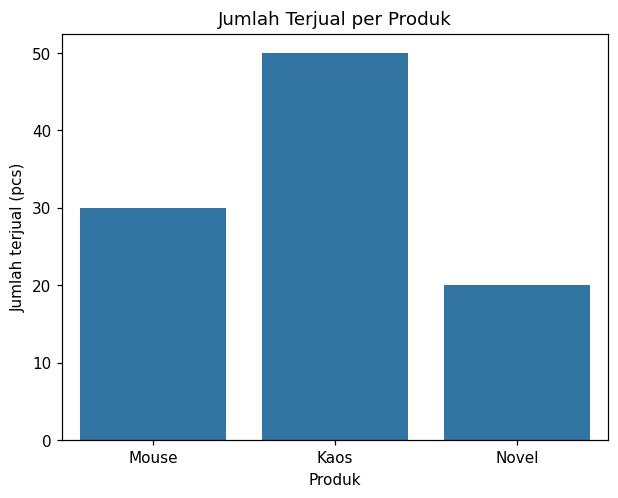

Plotly: satu baris, judul dan label di dalam `px`, hasilnya interaktif.

```python
# Plotly: satu baris, judul dan label di dalam px, hasilnya interaktif
fig = px.bar(tabel, x="produk", y="terjual", title="Jumlah Terjual per Produk",
             labels={"produk": "Produk", "terjual": "Jumlah terjual (pcs)"})
fig.show()
```

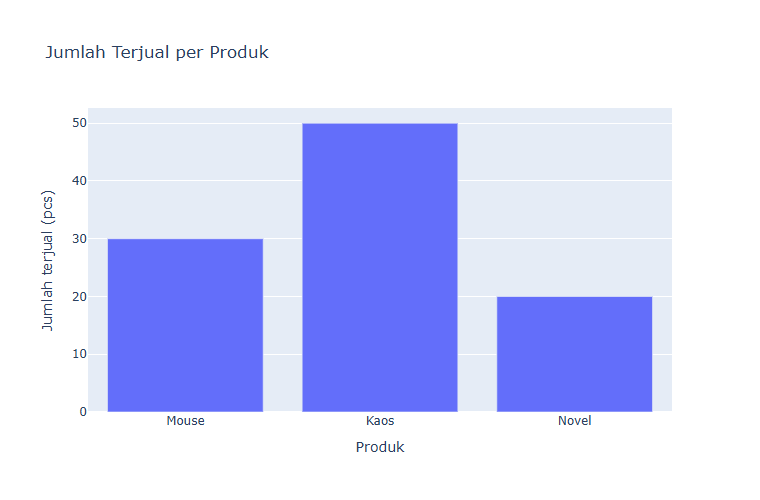

| Mau apa | Pakai | Alasan |
|---|---|---|
| Belajar dasar, atau butuh kontrol penuh atas gambar | Matplotlib | Semua bisa diatur, tapi kodenya lebih panjang |
| Analisis cepat dari DataFrame | Seaborn | Ringkas, tampilan enak, ada `hue` dan statistik otomatis |
| Dashboard atau presentasi online | Plotly | Interaktif, bisa disimpan jadi HTML |

### KPI: Angka yang Membantu Keputusan

**KPI** (*Key Performance Indicator*) adalah ukuran yang membantu **mengambil keputusan**. Beda dengan angka biasa: angka biasa cuma "informasi", KPI selalu dikaitkan dengan **tujuan**.

Contoh KPI untuk data penjualan:

| Tujuan yang ingin dijawab | KPI yang cocok |
|---|---|
| Seberapa besar omzet kita? | Total revenue |
| Seberapa ramai tokonya? | Jumlah transaksi |
| Berapa belanja rata-rata tiap pesanan? | Rata-rata nilai pesanan |
| Penjualan naik atau turun? | Pertumbuhan bulanan |

Pilih KPI yang **menjawab tujuan analisis**, bukan yang sekadar paling mudah dihitung. Menghitung jumlah baris di tabel itu gampang, tapi belum tentu menjawab pertanyaan apa pun.

### Rata-rata Nilai Pesanan dan Pertumbuhan

**Rata-rata nilai pesanan** (*Average Order Value*):

```text
Rata-rata nilai pesanan = Total Penjualan / Jumlah Pesanan
```

**Pertumbuhan bulanan** menunjukkan naik atau turunnya penjualan dibanding bulan sebelumnya, dalam persen:

```python
df_bulanan["pertumbuhan_%"] = df_bulanan["total_penjualan"].pct_change() * 100
```

- `pct_change()` — menghitung perubahan tiap baris dibanding baris sebelumnya. Baris pertama hasilnya kosong (`NaN`), karena tidak ada bulan sebelumnya untuk dibandingkan.

### Data Storytelling: Rumus Insight

Di pertemuan 4 kamu sudah belajar beda **temuan** dan **insight**. Sekarang kita punya rumusnya:

```text
Insight = temuan data + makna bisnis + rekomendasi
```

Contoh yang kurang:

- *"Elektronik penjualannya paling tinggi."* → ini baru temuan. Tidak ada makna, tidak ada tindakan.

- *"Penjualan turun 57%, bisnis harus panik."* → kesimpulan melebihi bukti (lihat bagian Jebakan).

Contoh yang baik:

> **Temuan:** Elektronik menyumbang 59,2% penjualan, tetapi hanya 18,6% dari jumlah transaksi.
> **Makna bisnis:** omzet sangat bergantung pada barang mahal yang jarang dibeli.
> **Rekomendasi:** jaga stok dan promosi Elektronik, sambil mendorong kategori lain yang transaksinya sering agar omzet tidak bertumpu pada satu kategori.

Satu hal lagi: selalu sebutkan **sumber data, skala (satuan), dan periode** saat menyampaikan insight. Tanpa itu, pembaca tidak bisa menilai seberapa bisa dipercaya insight tersebut. "Penjualan 75 juta" tanpa periode itu belum bermakna: sebulan, setahun, atau seminggu?

### Jebakan: Grafik Bisa Menipu

Di pertemuan 4, kamu menemukan satu transaksi **Laptop Gaming** senilai 31,5 juta di bulan Januari. Lihat apa yang terjadi kalau data itu dibuat jadi line chart tren bulanan:

- Dengan laptop itu: Januari 42,8 juta → Februari 18,2 juta. Kelihatan **anjlok 57,4%**.

- Tanpa laptop itu: Januari 11,3 juta → Februari 18,2 juta. Ternyata **naik 61,8%**.

Dua grafik dari data yang sama menceritakan dua cerita yang berlawanan, gara-gara **satu transaksi**. Kalau kita langsung menyimpulkan "penjualan sedang runtuh" tanpa memeriksa apa yang membentuk angkanya, kesimpulan kita **melebihi bukti**. Kita buktikan ini di langkah 17.

Kebiasaan yang perlu dibawa: sebelum menyimpulkan dari grafik, tanya dua hal — **apa yang membentuk angka ini**, dan **apakah ada satu data yang mendominasi**.

### Persiapan Sesi 6

Pertemuan 6 dikerjakan di **komputer sendiri**, bukan di Colab, supaya waktu kelas dipakai untuk praktik dashboard. Karena itu lingkungannya perlu disiapkan lebih dulu di rumah:

- Instal **Python 3.13** (di Windows, centang **Add Python to PATH**).

- Instal **VS Code** beserta ekstensi **Python**.

- Siapkan package lewat terminal VS Code (langkah lengkap ada di Hands-on nomor 21 dan di `panduan-setup.md`).

## Hands-on: Langkah demi Langkah

Sebelum masuk ke data penjualan, notebook diawali bagian **"0. Kenalan Dulu"**: empat jenis grafik (bar, line, histogram, scatter) di data kecil, termasuk contoh grafik jelek lalu dirapikan. Bagian ini cuma untuk pemanasan, jadi tidak diulang di sini. Langkah 1 di bawah mulai dari data penjualan yang asli.

### 1. Baca Data dan Siapkan Kolom

Pastikan `data-bersih.csv` sudah diupload ke Colab, lalu buat cell baru:

```python
import pandas as pd
import matplotlib.pyplot as plt
import seaborn as sns
import plotly.express as px

df = pd.read_csv("data-bersih.csv")
print(df["tanggal"].dtype)

df["tanggal"] = pd.to_datetime(df["tanggal"])
df["bulan"] = df["tanggal"].dt.to_period("M").astype(str)

print(df.shape)
display(df.head())
```

**Cek hasil:**

```text
object
(129, 11)
   id_pesanan    tanggal        nama_produk    kategori     harga  jumlah   wilayah   modal  nilai_penjualan    untung    bulan
0        1001 2026-01-05              Mouse  Elektronik  150000.0       2   Jakarta   95000         300000.0  110000.0  2026-01
1        1002 2026-01-29              Mouse  Elektronik  155000.0       2   Bandung  113000         310000.0   84000.0  2026-01
2        1003 2026-01-12  Speaker Bluetooth  Elektronik  313000.0       5  Karawang  196000        1565000.0  585000.0  2026-01
3        1004 2026-01-30        Novel Fiksi        Buku   62000.0       2  Karawang   39000         124000.0   46000.0  2026-01
4        1005 2026-02-23        Matras Yoga    Olahraga  121000.0       5   Bandung   71000         605000.0  250000.0  2026-02
```

- Tipe `tanggal` kembali `object` (teks). Ingat pertemuan 4: file CSV hanya menyimpan teks, jadi tipe tanggalnya hilang dan perlu `to_datetime` lagi.

- `(129, 11)`: 129 baris, 11 kolom (10 kolom asli + kolom `bulan` yang baru dibuat).

**Kalau error:** kalau muncul `FileNotFoundError`, cek `data-bersih.csv` sudah terupload (panel Files di Colab) dan namanya persis sama.

### 2. Siapkan Tabel Ringkasan

Dua tabel ini sama seperti pertemuan 4, ditambah kolom `total_juta` (dalam juta rupiah), dua kolom bantu dalam satuan ribu, dan dua variabel warna. Buat cell baru:

```python
ringkasan = (
    df.groupby("kategori", as_index=False)
      .agg(total_penjualan=("nilai_penjualan", "sum"),
           jumlah_transaksi=("id_pesanan", "nunique"))
      .sort_values("total_penjualan", ascending=False)
)
ringkasan["total_juta"] = ringkasan["total_penjualan"] / 1_000_000

df_bulanan = df.groupby("bulan", as_index=False).agg(
    total_penjualan=("nilai_penjualan", "sum")
)
df_bulanan["total_juta"] = df_bulanan["total_penjualan"] / 1_000_000

# kolom bantu dalam satuan ribu, dipakai di histogram dan scatter plot
df["harga_ribu"] = df["harga"] / 1000
df["modal_ribu"] = df["modal"] / 1000

# dua warna saja: satu warna utama, satu warna untuk menyorot
warna_utama = "#4d6b43"
warna_sorot = "#c9a66b"

display(ringkasan)
display(df_bulanan)
```

**Cek hasil:**

```text
     kategori  total_penjualan  jumlah_transaksi  total_juta
1  Elektronik       44893000.0                24      44.893
2     Fashion       15775000.0                27      15.775
4    Olahraga        7913000.0                26       7.913
0        Buku        3948000.0                29       3.948
3     Makanan        3275000.0                23       3.275
     bulan  total_penjualan  total_juta
0  2026-01       42775000.0      42.775
1  2026-02       18240000.0      18.240
2  2026-03       14789000.0      14.789
```

### 3. Grafik Pertama (Sengaja Jelek)

Ini grafik paling gampang ditulis. Lihat apa yang kurang. Buat cell baru:

```python
plt.bar(ringkasan["kategori"], ringkasan["total_penjualan"])
plt.show()
```

**Cek hasil:**

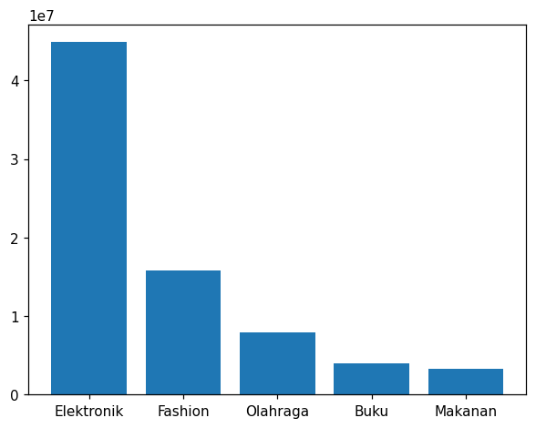

Yang kurang dari grafik ini:

- Tidak ada **judul**, pembaca tidak tahu ini grafik apa.

- Tidak ada **label sumbu**.

- Angka di sumbu Y tertulis `1e7` (notasi ilmiah) dan **satuannya tidak jelas**.

- Warna biru bawaan, tidak ada yang disorot.

### 4. Perbaiki Jadi Bar Chart yang Rapi

Data yang sama, tapi diperbaiki pakai checklist: judul, label sumbu, satuan juta, urut, dan satu warna sorot. Buat cell baru:

```python
urut = ringkasan.sort_values("total_juta")  # barh menggambar dari bawah, jadi urut kecil ke besar
terbesar = ringkasan.iloc[0]["kategori"]
warna = [warna_sorot if k == terbesar else warna_utama for k in urut["kategori"]]

plt.figure(figsize=(8, 4))
plt.barh(urut["kategori"], urut["total_juta"], color=warna)
plt.title("Total Penjualan per Kategori")
plt.xlabel("Total Penjualan (Rp juta)")
plt.ylabel("Kategori")
plt.xlim(0, 50)  # beri ruang di kanan supaya angka di ujung batang tidak terpotong

for i, nilai in enumerate(urut["total_juta"]):
    plt.text(nilai + 0.5, i, f"{nilai:.1f}", va="center")

plt.show()
```

**Cek hasil:**

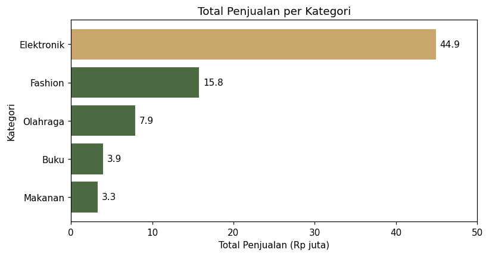

- Judulnya **Total Penjualan per Kategori**, sumbu X **Total Penjualan (Rp juta)**, sumbu Y **Kategori**.

- Elektronik (44,9 juta) disorot dengan warna emas, empat kategori lain berwarna hijau.

**Kalau error:** kalau muncul `KeyError: 'total_juta'` atau `NameError: name 'ringkasan' is not defined`, jalankan ulang cell Langkah 2.

### 5. Pie Chart vs Bar Chart

Data yang sama, dua grafik. Mana yang lebih gampang dibandingkan? Buat cell baru:

```python
fig, (kiri, kanan) = plt.subplots(1, 2, figsize=(11, 4))

kiri.pie(ringkasan["total_juta"], labels=ringkasan["kategori"], autopct="%1.1f%%")
kiri.set_title("Pie chart: irisan kecil sulit dibandingkan")

kanan.barh(urut["kategori"], urut["total_juta"], color=warna_utama)
kanan.set_title("Bar chart: urutan langsung kelihatan")
kanan.set_xlabel("Total Penjualan (Rp juta)")

plt.tight_layout()
plt.show()
```

**Cek hasil:**

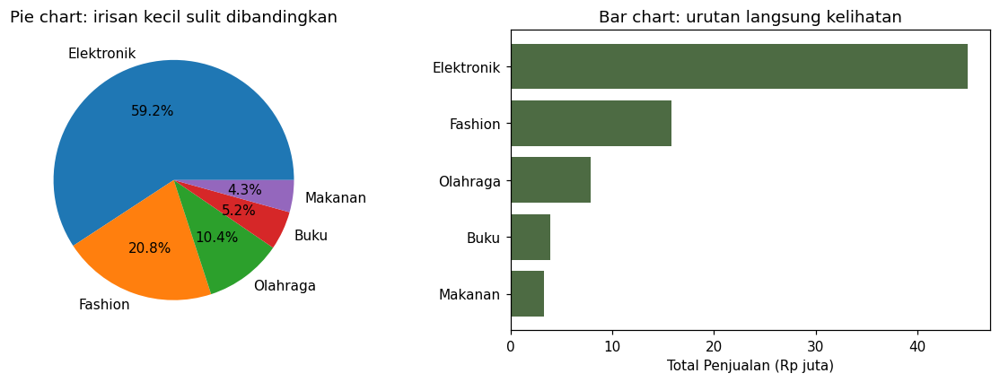

Di pie chart, label **Buku (5,2%)** dan **Makanan (4,3%)** saling bertumpuk, dan irisan kecil susah dibandingkan. Di bar chart, urutan dari terbesar sampai terkecil langsung kelihatan.

### 6. Line Chart: Tren Penjualan per Bulan

Buat cell baru:

```python
plt.figure(figsize=(8, 4))
plt.plot(df_bulanan["bulan"], df_bulanan["total_juta"], marker="o", color=warna_utama)
plt.title("Tren Penjualan Bulanan")
plt.xlabel("Bulan")
plt.ylabel("Total Penjualan (Rp juta)")
plt.ylim(0, 50)

for i, nilai in enumerate(df_bulanan["total_juta"]):
    plt.text(i, nilai + 1.5, f"{nilai:.1f}", ha="center")

plt.show()
```

**Cek hasil:**

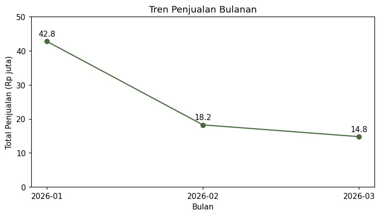

Judulnya **Tren Penjualan Bulanan**, sumbu X **Bulan**, sumbu Y **Total Penjualan (Rp juta)**. Garis turun dari 42,8 → 18,2 → 14,8 juta. Sumbu Y dimulai dari 0 supaya penurunannya tidak terlihat lebih dramatis dari kenyataan.

### 7. Histogram: Sebaran Harga

Kiri: semua data. Kanan: tanpa satu harga yang jauh di luar kebiasaan. Buat cell baru:

```python
biasa = df[df["harga"] <= 500000]

fig, (kiri, kanan) = plt.subplots(1, 2, figsize=(11, 4))

kiri.hist(df["harga_ribu"], bins=20, color=warna_utama)
kiri.set_title("Semua data")

kanan.hist(biasa["harga_ribu"], bins=20, color=warna_utama)
kanan.set_title(f"Harga sampai Rp 500 ribu ({len(biasa)} dari {len(df)} transaksi)")

for ax in (kiri, kanan):
    ax.set_xlabel("Harga (Rp ribu)")
    ax.set_ylabel("Jumlah transaksi")

plt.tight_layout()
plt.show()
```

**Cek hasil:**

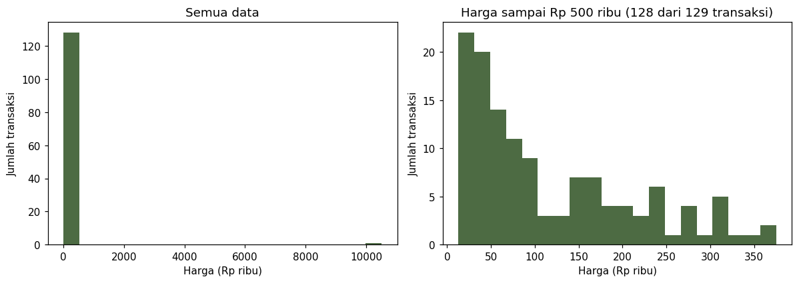

- **Kiri:** hampir semua data menumpuk di **satu batang** di paling kiri, dan ada satu titik kecil jauh di kanan (sekitar Rp 10,5 juta). Grafiknya gepeng dan tidak bisa dibaca.

- **Kanan:** setelah satu data itu dikeluarkan (128 dari 129 transaksi), barulah kelihatan bentuk sebarannya: kebanyakan produk harganya di bawah Rp 100 ribu, makin mahal makin jarang.

### 8. Boxplot dengan Seaborn

Mulai di sini kita pakai **Seaborn**. Boxplot adalah gambar dari aturan IQR di pertemuan 4. Buat cell baru:

```python
sns.set_theme(style="whitegrid")

fig, (kiri, kanan) = plt.subplots(1, 2, figsize=(12, 3.2))

sns.boxplot(x=df["harga_ribu"], color=warna_utama, ax=kiri)
kiri.set_title("Semua data: kotaknya terjepit")

sns.boxplot(x=biasa["harga_ribu"], color=warna_utama, ax=kanan)
kanan.set_title("Harga sampai Rp 500 ribu: kotak terbaca")

for ax in (kiri, kanan):
    ax.set_xlabel("Harga (Rp ribu)")

plt.tight_layout()
plt.show()

q1 = df["harga"].quantile(0.25)
q3 = df["harga"].quantile(0.75)
batas_atas = q3 + 1.5 * (q3 - q1)
print("Batas atas IQR:", batas_atas)
print("Jumlah titik di atas batas:", (df["harga"] > batas_atas).sum())
```

**Cek hasil:**

```text
Batas atas IQR: 378500.0
Jumlah titik di atas batas: 1
```

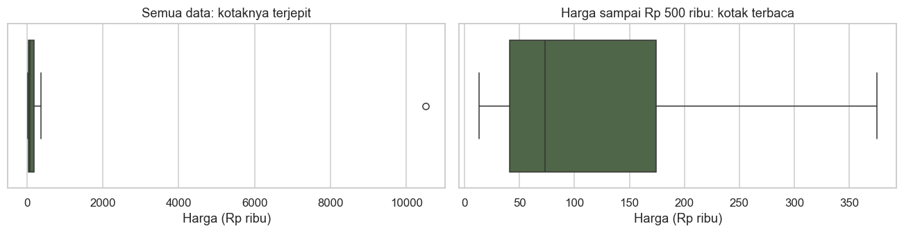

- **Kiri:** kotaknya terjepit di ujung kiri karena skala ditarik oleh satu titik di paling kanan (Laptop Gaming). Itulah satu-satunya outlier menurut aturan IQR, sesuai angka `1` di atas.

- **Kanan:** tanpa titik itu, kotaknya terbaca jelas. Garis di tengah kotak adalah median.

### 9. Scatter Plot: Harga vs Modal

Titik di atas garis putus-putus = untung. Titik di bawahnya = rugi (harga jual lebih rendah dari modal). Buat cell baru:

```python
tanpa_laptop = df[df["nama_produk"] != "Laptop Gaming (Bonus)"]

fig, (kiri, kanan) = plt.subplots(1, 2, figsize=(12, 4.5))

sns.scatterplot(data=df, x="modal_ribu", y="harga_ribu", hue="kategori", ax=kiri)
kiri.set_title("Semua data: Laptop Gaming memaksa skala")

sns.scatterplot(data=tanpa_laptop, x="modal_ribu", y="harga_ribu", hue="kategori", ax=kanan)
batas = tanpa_laptop[["modal_ribu", "harga_ribu"]].max().max()
kanan.plot([0, batas], [0, batas], "--", color="gray")  # garis impas: harga = modal
kanan.set_title("Tanpa Laptop Gaming: titik di bawah garis = rugi")

for ax in (kiri, kanan):
    ax.set_xlabel("Modal (Rp ribu)")
    ax.set_ylabel("Harga jual (Rp ribu)")

plt.tight_layout()
plt.show()

print("Jumlah transaksi rugi:", (df["untung"] < 0).sum())
```

**Cek hasil:**

```text
Jumlah transaksi rugi: 3
```

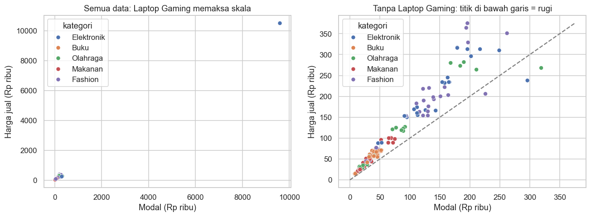

- **Kiri:** satu titik di pojok kanan atas (Laptop Gaming) memaksa semua titik lain menumpuk di pojok kiri bawah.

- **Kanan:** tanpa laptop, titiknya menyebar rapi mengikuti garis miring: modal makin besar, harga jual makin besar.

- Ada **3 titik di bawah garis putus-putus**: tiga transaksi yang dijual lebih murah dari modalnya (rugi). Ini sama dengan 3 baris rugi yang kamu temukan di pertemuan 3.

### 10. Bar Chart Versi Seaborn

Hasilnya mirip langkah 4, tapi kodenya lebih pendek. Buat cell baru:

```python
plt.figure(figsize=(8, 4))
sns.barplot(data=ringkasan, x="total_juta", y="kategori", color=warna_utama)
plt.title("Total Penjualan per Kategori")
plt.xlabel("Total Penjualan (Rp juta)")
plt.ylabel("Kategori")
plt.show()
```

**Cek hasil:**

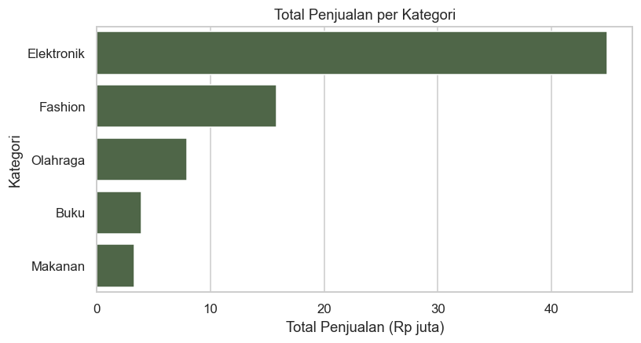

### 11. Heatmap: Tabel yang Diberi Warna

Ini `pivot_table` wilayah × kategori dari pertemuan 4, sekarang diwarnai. Buat cell baru:

```python
pivot = pd.pivot_table(df, values="nilai_penjualan", index="wilayah",
                       columns="kategori", aggfunc="sum", fill_value=0) / 1_000_000
pivot_tanpa = pd.pivot_table(tanpa_laptop, values="nilai_penjualan", index="wilayah",
                             columns="kategori", aggfunc="sum", fill_value=0) / 1_000_000

display(pivot.round(1))

fig, (kiri, kanan) = plt.subplots(1, 2, figsize=(13, 4.5))

sns.heatmap(pivot, annot=True, fmt=".1f", cmap="Greens", ax=kiri)
kiri.set_title("Semua data (Rp juta)")

sns.heatmap(pivot_tanpa, annot=True, fmt=".1f", cmap="Greens", ax=kanan)
kanan.set_title("Tanpa Laptop Gaming (Rp juta)")

plt.tight_layout()
plt.show()
```

**Cek hasil:**

```text
kategori  Buku  Elektronik  Fashion  Makanan  Olahraga
wilayah                                               
Bandung    0.8        35.2      1.3      0.3       1.1
Jakarta    0.4         2.4      5.7      1.0       1.6
Karawang   0.3         2.0      4.5      0.7       1.8
Medan      0.7         3.8      3.4      0.4       1.8
Surabaya   1.7         1.5      0.9      0.9       1.7
```

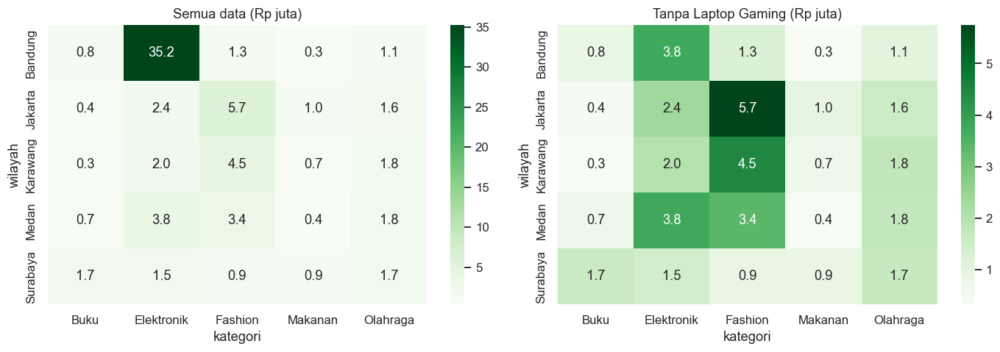

- **Kiri (semua data):** kotak **Bandung × Elektronik = 35,2 juta** berwarna hijau tua sendirian, sementara kotak lain pucat semua. Sekilas terlihat seolah Bandung adalah wilayah super.

- **Kanan (tanpa Laptop Gaming):** kotak itu turun jadi 3,8 juta. Sekarang yang paling pekat adalah **Jakarta × Fashion = 5,7 juta**. Polanya jadi lebih jujur.

### 12. Heatmap Korelasi

Buat cell baru:

```python
kolom = ["harga", "jumlah", "modal", "nilai_penjualan", "untung"]

display(df[kolom].corr().round(2))

fig, (kiri, kanan) = plt.subplots(1, 2, figsize=(14, 5))

sns.heatmap(df[kolom].corr(), annot=True, fmt=".2f", cmap="coolwarm",
            vmin=-1, vmax=1, ax=kiri)
kiri.set_title("Korelasi: semua data")

sns.heatmap(tanpa_laptop[kolom].corr(), annot=True, fmt=".2f", cmap="coolwarm",
            vmin=-1, vmax=1, ax=kanan)
kanan.set_title("Korelasi: tanpa Laptop Gaming")

plt.tight_layout()
plt.show()
```

**Cek hasil:**

```text
                 harga  jumlah  modal  nilai_penjualan  untung
harga             1.00   -0.00   1.00             1.00    0.89
jumlah           -0.00    1.00  -0.00             0.06    0.21
modal             1.00   -0.00   1.00             1.00    0.87
nilai_penjualan   1.00    0.06   1.00             1.00    0.91
untung            0.89    0.21   0.87             0.91    1.00
```

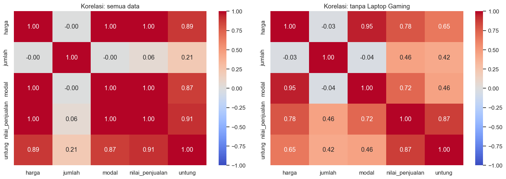

Bandingkan dua heatmap itu:

- **harga vs modal:** 1,00 (semua data) menjadi 0,95 (tanpa laptop). Masih sangat tinggi, wajar karena harga jual memang mengikuti modal.

- **harga vs nilai_penjualan:** 1,00 menjadi 0,78. Satu laptop membuat korelasinya terlihat **sempurna**, padahal aslinya tidak sekuat itu.

- **harga vs jumlah:** hampir 0 di keduanya. Harga tidak menentukan berapa banyak barang yang dibeli per transaksi.

- Ingat: `nilai_penjualan` dihitung dari `harga × jumlah`, jadi korelasinya dengan dua kolom itu tinggi **karena rumus**, bukan karena temuan.

### 13. Plotly: Grafik Interaktif

Buat cell baru:

```python
fig = px.line(df_bulanan, x="bulan", y="total_juta", markers=True,
              range_y=[0, 50], title="Tren Penjualan Bulanan")
fig.update_xaxes(type="category")  # "2026-01" itu teks, jangan dianggap tanggal oleh Plotly
fig.update_layout(xaxis_title="Bulan", yaxis_title="Total Penjualan (Rp juta)")
fig.show()
```

**Cek hasil:**

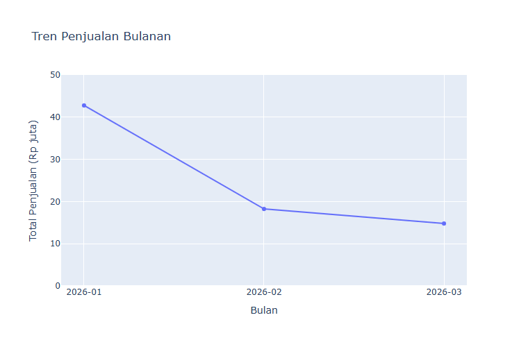

Di Colab, arahkan kursor ke titik-titiknya: muncul angka bulan dan total penjualannya. Kamu juga bisa zoom dengan menyeret area grafik.

**Kalau error:** kalau sumbu X menampilkan tanggal seperti "Jan 11" dan bukan "2026-01", cek baris `fig.update_xaxes(type="category")`. Tanpa baris itu, Plotly mengira "2026-01" adalah tanggal.

### 14. Plotly: Scatter dengan Nama Produk

Buat cell baru:

```python
fig = px.scatter(tanpa_laptop, x="modal", y="harga", color="kategori",
                 hover_name="nama_produk", title="Harga vs Modal (tanpa Laptop Gaming)")
fig.update_layout(xaxis_title="Modal (Rp)", yaxis_title="Harga jual (Rp)")
fig.show()
```

**Cek hasil:**

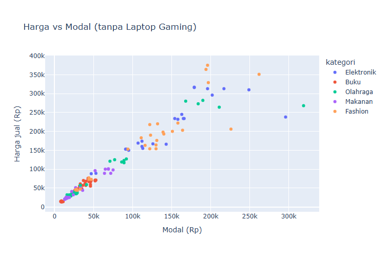

Arahkan kursor ke satu titik: muncul **nama produknya** (dari `hover_name`), beserta modal dan harganya. Klik nama kategori di legenda untuk menyembunyikan atau menampilkan kategori itu.

### 15. KPI: Angka yang Membantu Keputusan

Rata-rata nilai pesanan = total penjualan dibagi jumlah pesanan. Buat cell baru:

```python
def format_rupiah(angka):
    return "Rp " + f"{angka:,.0f}".replace(",", ".")

total_revenue = df["nilai_penjualan"].sum()
jumlah_transaksi = df["id_pesanan"].nunique()
rata_nilai_pesanan = total_revenue / jumlah_transaksi

kpi = pd.DataFrame({
    "KPI": ["Total revenue", "Jumlah transaksi", "Rata-rata nilai pesanan"],
    "Nilai": [format_rupiah(total_revenue), jumlah_transaksi, format_rupiah(rata_nilai_pesanan)],
})
display(kpi)

df_bulanan["pertumbuhan_%"] = (df_bulanan["total_penjualan"].pct_change() * 100).round(1)
display(df_bulanan[["bulan", "total_juta", "pertumbuhan_%"]])
```

**Cek hasil:**

```text
                       KPI          Nilai
0            Total revenue  Rp 75.804.000
1         Jumlah transaksi            129
2  Rata-rata nilai pesanan     Rp 587.628
     bulan  total_juta  pertumbuhan_%
0  2026-01      42.775            NaN
1  2026-02      18.240          -57.4
2  2026-03      14.789          -18.9
```

- Total revenue Rp 75.804.000 dari 129 transaksi, jadi rata-rata nilai pesanan **Rp 587.628**.

- Pertumbuhan Februari **-57,4%** dan Maret **-18,9%**. Baris Januari kosong (`NaN`) karena tidak ada bulan sebelumnya. Ingat, angka -57,4% ini belum diperiksa: lihat Langkah 17.

### 16. Porsi Penjualan vs Porsi Transaksi

Kategori yang paling besar penjualannya belum tentu yang paling sering dibeli. Buat cell baru:

```python
porsi = ringkasan.copy()
porsi["porsi_penjualan"] = porsi["total_penjualan"] / porsi["total_penjualan"].sum() * 100
porsi["porsi_transaksi"] = porsi["jumlah_transaksi"] / porsi["jumlah_transaksi"].sum() * 100

display(porsi[["kategori", "porsi_penjualan", "porsi_transaksi"]].round(1))

porsi.set_index("kategori")[["porsi_penjualan", "porsi_transaksi"]].plot(
    kind="bar", figsize=(9, 4.5), color=[warna_utama, warna_sorot]
)
plt.title("Porsi Penjualan vs Porsi Transaksi per Kategori")
plt.xlabel("Kategori")
plt.ylabel("Porsi (%)")
plt.xticks(rotation=0)
plt.legend(["Porsi penjualan", "Porsi transaksi"])
plt.show()
```

**Cek hasil:**

```text
     kategori  porsi_penjualan  porsi_transaksi
1  Elektronik             59.2             18.6
2     Fashion             20.8             20.9
4    Olahraga             10.4             20.2
0        Buku              5.2             22.5
3     Makanan              4.3             17.8
```

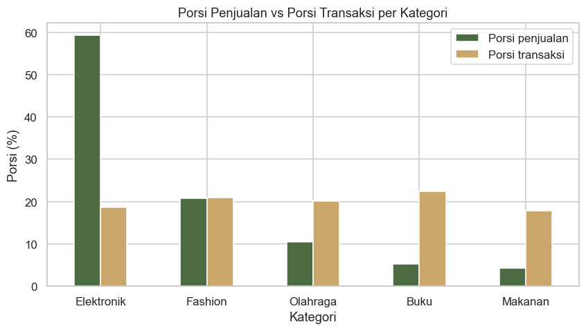

- **Elektronik:** 59,2% dari penjualan, tapi hanya 18,6% dari transaksi.

- **Buku:** hanya 5,2% dari penjualan, tapi 22,5% dari transaksi (paling sering dibeli).

- Di Fashion, porsi penjualan dan transaksinya seimbang (sekitar 21%).

### 17. Jebakan: Grafik Bisa Menipu

Lihat apa yang terjadi pada tren bulanan kalau satu transaksi Laptop Gaming dikeluarkan. Buat cell baru:

```python
bulanan_tanpa = tanpa_laptop.groupby("bulan", as_index=False).agg(
    total_penjualan=("nilai_penjualan", "sum")
)
bulanan_tanpa["total_juta"] = bulanan_tanpa["total_penjualan"] / 1_000_000
bulanan_tanpa["pertumbuhan_%"] = (bulanan_tanpa["total_penjualan"].pct_change() * 100).round(1)

display(bulanan_tanpa[["bulan", "total_juta", "pertumbuhan_%"]])

fig, (kiri, kanan) = plt.subplots(1, 2, figsize=(11, 4), sharey=True)

kiri.plot(df_bulanan["bulan"], df_bulanan["total_juta"], marker="o", color=warna_utama)
kiri.set_title("Semua data: kelihatan anjlok")

kanan.plot(bulanan_tanpa["bulan"], bulanan_tanpa["total_juta"], marker="o", color=warna_sorot)
kanan.set_title("Tanpa 1 transaksi Laptop Gaming")

for ax in (kiri, kanan):
    ax.set_xlabel("Bulan")
    ax.set_ylim(0, 50)
kiri.set_ylabel("Total Penjualan (Rp juta)")

plt.tight_layout()
plt.show()
```

**Cek hasil:**

```text
     bulan  total_juta  pertumbuhan_%
0  2026-01      11.275            NaN
1  2026-02      18.240           61.8
2  2026-03      14.789          -18.9
```

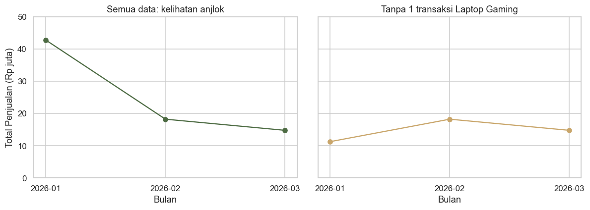

- **Kiri:** penjualan kelihatan anjlok dari Januari ke Februari.

- **Kanan:** tanpa satu transaksi itu, Februari justru **naik 61,8%**, lalu Maret turun 18,9%.

- Sumbu Y sengaja dikunci sama (`sharey=True`, 0 sampai 50) supaya dua grafik adil dibandingkan.

Pelajarannya: tren "anjlok 57%" tadi ternyata digerakkan **satu transaksi**. Menyimpulkan "penjualan sedang runtuh" dari grafik kiri berarti **kesimpulan melebihi bukti**.

### 18. Menulis Insight

Angka di temuan diambil langsung dari tabel `porsi`, bukan diketik manual. Buat cell baru:

```python
elektronik = porsi[porsi["kategori"] == "Elektronik"].iloc[0]

print(f"Temuan: Elektronik menyumbang {elektronik['porsi_penjualan']:.1f}% penjualan, "
      f"tetapi hanya {elektronik['porsi_transaksi']:.1f}% dari jumlah transaksi.")
print("Makna bisnis: omzet sangat bergantung pada barang mahal yang jarang dibeli.")
print("Rekomendasi: jaga stok dan promosi Elektronik, sambil mendorong kategori lain "
      "yang transaksinya sering agar omzet tidak bertumpu pada satu kategori.")
print("Sumber: data-bersih.csv, periode Januari-Maret 2026, satuan rupiah.")
```

**Cek hasil:**

```text
Temuan: Elektronik menyumbang 59.2% penjualan, tetapi hanya 18.6% dari jumlah transaksi.
Makna bisnis: omzet sangat bergantung pada barang mahal yang jarang dibeli.
Rekomendasi: jaga stok dan promosi Elektronik, sambil mendorong kategori lain yang transaksinya sering agar omzet tidak bertumpu pada satu kategori.
Sumber: data-bersih.csv, periode Januari-Maret 2026, satuan rupiah.
```

Periksa insight ini dengan rumus: ada **temuan** (angka dari data), ada **makna bisnis**, ada **rekomendasi**, dan ada **sumber, periode, dan satuan**.

### 19. Simpan Grafik Jadi File

Berguna kalau grafik mau dipakai di laporan atau README proyek. Buat cell baru:

```python
import os

plt.figure(figsize=(8, 4))
plt.barh(urut["kategori"], urut["total_juta"], color=warna)
plt.title("Total Penjualan per Kategori")
plt.xlabel("Total Penjualan (Rp juta)")
plt.ylabel("Kategori")
plt.savefig("grafik_penjualan_kategori.png", dpi=150, bbox_inches="tight")
plt.close()

print("Tersimpan:", os.path.exists("grafik_penjualan_kategori.png"))
```

**Cek hasil:**

```text
Tersimpan: True
```

Di Colab, buka panel Files (ikon folder di kiri): ada file baru `grafik_penjualan_kategori.png`. Klik kanan, **Download** kalau mau disimpan ke laptop. Ingat, file di Colab bersifat sementara.

### 20. Latihan Gabungan

Pakai `data-bersih.csv`, kerjakan sendiri (jangan dulu lihat jawaban):

- Buat **bar chart** total `untung` per `kategori`, urut dari terbesar.

- Buat **line chart** jumlah transaksi per bulan.

- Tukar hasilnya dengan temanmu, lalu cek pakai checklist: judul jelas, label sumbu ada, satuan terbaca, warna tidak berlebihan, kesimpulan tidak melebihi bukti.

Ada satu pertanyaan tambahan: kalau grafiknya diperlihatkan ke atasanmu, kesimpulan apa yang **aman** ditarik, dan apa yang **belum boleh**?

### 21. Persiapan Sesi 6 (Dikerjakan di Rumah)

Langkah ini **bukan di Colab**, tapi di komputer sendiri:

1. Instal [Python 3.13](https://www.python.org/downloads/release/python-3130/). Di Windows, centang **Add Python to PATH**.

2. Instal [VS Code](https://code.visualstudio.com/Download) dan ekstensi **Python** dari Microsoft.

3. Buka Terminal VS Code di folder proyek, lalu jalankan:

```bash
python -m venv .venv
.venv\Scripts\activate
pip install streamlit pandas numpy matplotlib seaborn plotly
```

4. Cek apakah berhasil:

```bash
streamlit hello
```

**Cek hasil:** browser terbuka otomatis menampilkan halaman demo Streamlit. Tekan `Ctrl + C` di terminal untuk menghentikannya.

**Kalau error:** kalau perintah `python` tidak dikenali, tutup lalu buka lagi VS Code setelah instalasi, atau pakai `py` di Windows. Panduan lengkap ada di `panduan-setup.md`.

### Hasil Akhir Sesi Ini

Notebook `pertemuan-5.ipynb` berisi 130 cell (61 di antaranya kode): pemanasan 4 jenis grafik di data kecil, cara kerja Matplotlib/Seaborn/Plotly dengan contoh simple (bagian 0b), panduan grafik mana untuk masalah apa (0c), lalu di data penjualan asli — grafik jelek dirapikan, bar chart, pie vs bar, line chart, histogram, boxplot, scatter, heatmap (pivot dan korelasi), versi Seaborn dan Plotly, 4 KPI, porsi penjualan vs transaksi, jebakan Laptop Gaming, menulis insight, dan menyimpan grafik, ditutup Cheatsheet. Di notebook, tiap grafik dari `data-bersih.csv` (bar kategori, pie, histogram, boxplot, scatter, heatmap pivot, heatmap korelasi, porsi, jebakan Laptop Gaming) punya **versi interaktif Plotly** tepat di bawah versi Matplotlib/Seaborn-nya: kursor diarahkan untuk melihat angka, bisa di-zoom. Kode README memakai versi statisnya, versi interaktif ada di notebook. Semua langkah penjualan dibangun dari `data-bersih.csv`, hasil cleaning pertemuan 4.

## Catatan AI

Contoh prompt yang baik: "Jelaskan kenapa pie chart kurang cocok untuk membandingkan lima kategori penjualan, dan apa alternatifnya. Jangan buatkan kode grafik untuk latihan mandiri saya." Verifikasi selalu hasilnya dengan menjalankan kode di Colab, dan cek grafiknya pakai checklist: AI bisa membuat grafik yang kelihatan bagus tapi tidak punya judul, satuan, atau kesimpulannya melebihi bukti.

## Latihan Mandiri

Pakai `data-bersih.csv`: buat satu grafik yang menjawab pertanyaan "wilayah mana yang paling banyak transaksinya?", lalu tulis satu insight dengan rumus **temuan → makna bisnis → rekomendasi**, lengkap dengan sumber, periode, dan satuan. Periksa grafikmu dengan checklist lima poin.

## Rangkuman

Hari ini angka dan tabel dari pertemuan 4 diubah jadi **grafik**. Pilih grafik dari pertanyaannya: bar chart untuk membandingkan kategori, line chart untuk tren waktu, histogram atau boxplot untuk sebaran, scatter plot untuk hubungan dua angka, dan heatmap untuk tabel dua dimensi (termasuk korelasi). **Matplotlib** adalah dasarnya, **Seaborn** membuat kodenya lebih ringkas, **Plotly** membuat grafik interaktif. Grafik yang baik punya judul, label sumbu, satuan, warna secukupnya, dan kesimpulan yang tidak melebihi bukti. KPI adalah ukuran yang dipilih berdasarkan tujuan analisis, misalnya total revenue, jumlah transaksi, rata-rata nilai pesanan, dan pertumbuhan bulanan. Insight ditulis dengan rumus **temuan data + makna bisnis + rekomendasi**, sambil menyebut sumber, skala, dan periode. Contoh Laptop Gaming mengingatkan kita bahwa satu data ekstrem bisa membuat grafik menceritakan hal yang keliru, jadi **selalu periksa apa yang membentuk angkanya**. Minggu depan semua ini (tabel, grafik, KPI) dirakit menjadi **dashboard Streamlit** yang jalan di komputer sendiri.

## Istilah Penting

| Istilah | Artinya |
|---|---|
| Visualisasi | Menampilkan data dalam bentuk gambar/grafik supaya pola lebih mudah dilihat |
| Bar chart | Grafik batang, untuk membandingkan kategori |
| Line chart | Grafik garis, untuk melihat perubahan dari waktu ke waktu |
| Histogram | Grafik sebaran: berapa banyak data di tiap rentang angka |
| Boxplot | Grafik ringkas sebaran: kotak Q1–Q3, median, batas wajar, dan titik outlier |
| Scatter plot | Grafik titik untuk melihat hubungan dua angka |
| Heatmap | Tabel yang diwarnai sesuai besar angkanya |
| Korelasi | Ukuran (-1 sampai 1) seberapa kompak dua angka bergerak bersama; bukan sebab-akibat |
| Matplotlib | Library dasar untuk membuat grafik di Python |
| Seaborn | Library grafik di atas Matplotlib, lebih ringkas dan paham DataFrame |
| Plotly | Library grafik interaktif (hover dan zoom) |
| Sumbu | Garis acuan di grafik (sumbu X mendatar, sumbu Y tegak) beserta labelnya |
| KPI | *Key Performance Indicator*: ukuran yang membantu mengambil keputusan |
| Rata-rata nilai pesanan | Total penjualan dibagi jumlah pesanan |
| Pertumbuhan | Persentase naik/turun dibanding periode sebelumnya |
| Insight | Temuan data + makna bisnis + rekomendasi |
| Data storytelling | Menyampaikan hasil analisis sebagai cerita yang jelas dan bisa ditindaklanjuti |
| Checklist grafik | Judul jelas, label sumbu ada, satuan terbaca, warna tidak berlebihan, kesimpulan tidak melebihi bukti |
